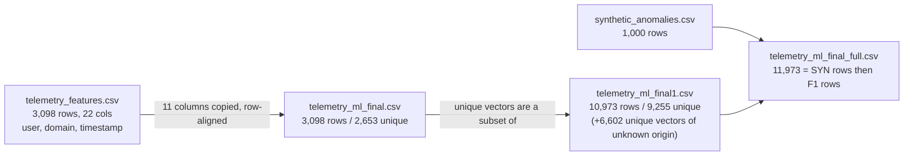

# Data lineage: the friend's CSVs

All numbers measured from the files (stdlib + pandas); nothing taken from the report. Source folder: `Research Papers/BE Project - BrowserShield/` (read-only; `data/raw/MANIFEST.json` records the SHA-256 of every source file, verified identical before and after de-identification).

## 1. Inventory (5 CSVs; none in any subfolder)

| File | Rows | Cols | Labels | user / domain / timestamp | What it is |
|---|---|---|---|---|---|
| `telemetry_features.csv` | 3,098 | 22 | none | **yes / yes / yes** (6 users, 78 domains, 4.83 days) | Raw collected telemetry, one row per tab per snapshot |
| `telemetry_ml_final.csv` | 3,098 | 11 | none | no | The 11 model features, **row-aligned 1:1 with the raw file** (0 mismatches across all 11 columns). 2,653 unique vectors |
| `telemetry_ml_final1.csv` | 10,973 | 11 | none (notebook sets `isAnomaly=0`) | no | "Normal" set. **Superset of `final` by unique vector** (2,653 of 2,653 present). 9,255 unique vectors; 1,718 exact duplicate rows |
| `synthetic_anomalies.csv` | 1,000 | 11 | none (notebook sets `isAnomaly=1`) | no | Synthetic "attack" rows. 0 duplicates; 0 identical to any real vector. Generator script not in the folder |
| `telemetry_ml_final_full.csv` | 11,973 | 11 | none | no | **Exactly `synthetic` (rows 0-999) followed by `final1` (rows 1000-11972)**, verified row by row. An unlabelled merge |

Class counts when the notebook labels them: 10,973 normal, 1,000 attack (8.35%).

## 2. How they relate

Provenance of `final1`'s 9,255 unique vectors, found by matching each vector to the raw file's users:

| Vector matches... | Unique vectors |
|---|---|
| exactly 1 user (gets that user as group) | 2,638 (of which: user #1 1,395; #2 644; #3 310; #4 284; two tiny users 4 and 1) |
| 2 or more users (incl. the all-zero idle vector, which all 6 users produce) | 15 |
| no raw row (**unknown source**) | 6,602 |

So **71% of the unique "normal" vectors have no recoverable user.** They are one group, `unknown_source` (6,617 rows after adding the 15 multi-user vectors), never split across train and test.

## 3. Which file is "final"? (your rule: a, then b, then c)

**Chosen: `telemetry_ml_final1.csv` as the normal class, with attacks coming from `synthetic_anomalies.csv`. Together these equal the rows of `telemetry_ml_final_full.csv`.** This is **Reading A**.

| Rule | Evidence |
|---|---|
| (a) What the final notebook loads for training | `CryptoShield_Final.ipynb` cell 4 loads `synthetic_anomalies.csv` (`df1`, label 1) and `telemetry_ml_final1.csv` (`df2`, label 0). Section 2 (cell 28) starts from `df_anomaly = df1.copy()` and `df_normal = df2.copy()`. `telemetry_ml_final_full.csv` is loaded only for the scaler / Isolation Forest demo (cells 6 and 13). `telemetry_ml_final.csv` is not loaded by the final notebook. |
| (b) Row count matches reported sizes | Reported train 8,381 + val 1,796 + test 1,796 = **11,973** = 10,973 + 1,000. Using `telemetry_ml_final.csv` would give 3,098 + 1,000 = 4,098, which does not match. |
| (c) Superset | `final1` contains every unique vector of `final`. |

**Alternative reading, kept for comparison: Reading B** = the literal `telemetry_ml_final.csv` (3,098 rows, 2,653 unique). It fails (a) and (b), but it is the only reading where every row has provenance.

**Caveat:** the final notebook regenerates the anomalies in section 2.2 (tiers from percentiles of the normal data) rather than using the 1,000 CSV rows. The *counts* match, but the rows he evaluated are not the CSV rows, and the generator is not saved as a script.

## 4. Do the two readings differ materially? (your 5% rule)

Yes. After exact-duplicate removal and the locked test split (identical test set in both):

| | Reading A | Reading B |
|---|---|---|
| Unique normal rows | 9,255 | 2,653 |
| Dev normal rows | **8,327** | **1,725** (4.8x fewer) |
| Test normal rows | 928 | 928 (same rows) |
| Validation folds (leave-one-group-out, >= 50 rows) | 3 (user #1, user #3, unknown_source) | 2 (user #1, user #3) |
| `unknown_source` rows in dev | 6,617 | 15 |

Stage B was therefore run under both (`docs/STAGE_B_REPORT.md`).

## 5. How each file is used in this project

| File | Use | Why |
|---|---|---|
| `normal_final1_deid.csv` (from `final1`) | **Primary** normal data (Reading A) | Section 3 |
| `telemetry_raw_deid.csv` (from raw) | Reading B's normals; uptime/regime checks; temporal-structure checks | Only file with user, time and the underlying counters |
| `synthetic_anomalies.csv` | Adversarial-validity check (Stage B), and later the baseline reproduction | It is what he trained against |
| `telemetry_ml_final_full.csv` | **Not used.** Only verified to equal synthetic + final1 | Redundant, and unlabelled |
| Files are never mixed into one training set without a documented reason | | |

## 6. Two facts about the features that the lineage exposed

1. **The "per_second" features are not per second.** In the raw file, `dom_per_second`, `lag_per_second`, `network_per_second` equal `count / page_uptime_ms` when uptime > 0 (**per millisecond**, matches 96-99% of rows) and equal the **raw count** when uptime is 0 (matches the same rows). The two regimes differ by about 1000x.
2. **The counts are cumulative since page load**, not per-interval deltas. The longest recovered uptime is 82,095,497 ms (22.8 hours), which also explains the 74-million-ms `event_loop_lag_ms` maximum I earlier called a "collection artefact" in `ANALYSIS.md`. It is a long-lived tab.
